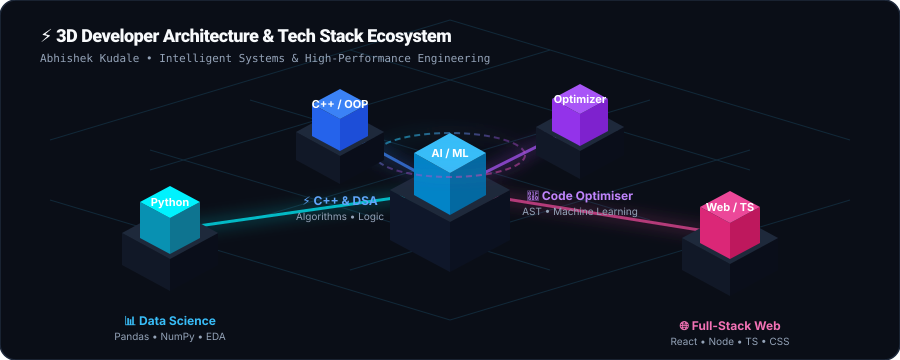
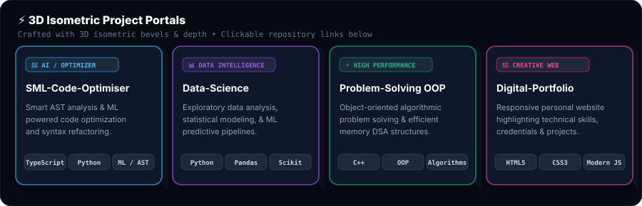
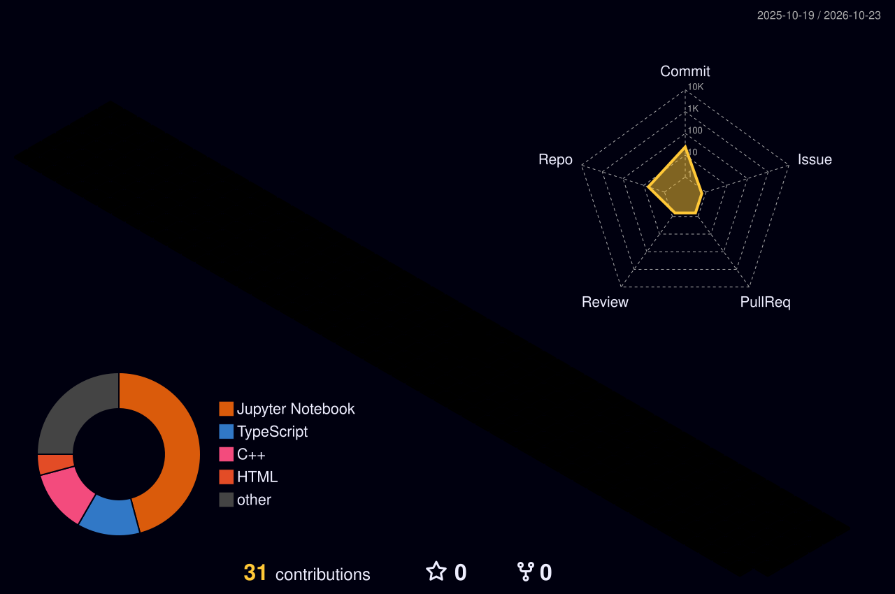

<div align="center">

  <!-- DYNAMIC GRADIENT HEADER BANNER -->
  <a href="https://github.com/Abhi-dev-02">
    
  </a>

  <!-- TYPING SVG ANIMATION -->
  <a href="https://github.com/Abhi-dev-02">
    
  </a>

  <br/>

  <!-- QUICK HIGHLIGHT BADGES -->
  <p align="center">
    
    
    
    
  </p>

  <!-- QUICK CONNECT BUTTONS -->
  <p align="center">
    <a href="mailto:abhishekkudale0201@gmail.com">
      
    </a>
    <a href="https://github.com/Abhi-dev-02">
      
    </a>
    <a href="https://github.com/Abhi-dev-02/Digital-Portfolio">
      
    </a>
  </p>

</div>

---

### 🚀 About Me

```json
{
  "name": "Abhishek Kudale",
  "title": "Computer Science & Engineering (AI & ML) Student",
  "university": "MIT Academy of Engineering (MITAOE), Pune 🎓",
  "core_competencies": [
    "Artificial Intelligence & Machine Learning 🧠",
    "Data Science, Analytics & Feature Engineering 📊",
    "Full-Stack Web Engineering & Responsive UI 🌐",
    "Object-Oriented Design & Algorithm Optimization (C++) ⚡"
  ],
  "current_focus": "Developing intelligent ML pipelines, mastering system design & competitive programming",
  "philosophy": "Writing clean, readable, and impactful code that bridges intelligent algorithms with real-world utility."
}
```

- 👨‍💻 **Who I Am**: A proactive developer and B.Tech CSE (AIML) student with a deep curiosity for Artificial Intelligence, Data Science, and modern Web Technologies.
- 🎯 **What I Do**: I design responsive frontends, construct end-to-end data analytics workflows, and implement algorithmic solutions in C++ and Python.
- 🔭 **Current Pursuits**: Diving deep into advanced deep learning frameworks, neural network architectures, and full-stack integration.
- 🤝 **Collaboration**: Always excited to collaborate on open-source projects, machine learning research, and high-impact web applications.

---

### 🧊 3D Developer Architecture & Tech Ecosystem

<div align="center">
  
</div>

<br/>

<div align="center">
  
</div>

<br/>

<table align="center" width="100%">
  <tr>
    <td width="50%" valign="top">
      <h4>🧠 AI, Machine Learning & Data Science</h4>
      <p>
        
        
        
        
        
        
      </p>
    </td>
    <td width="50%" valign="top">
      <h4>💻 Programming & Algorithms</h4>
      <p>
        
        
        
        
        
        
      </p>
    </td>
  </tr>
  <tr>
    <td width="50%" valign="top">
      <h4>🌐 Web Engineering & Frontend</h4>
      <p>
        
        
        
        
        
      </p>
    </td>
    <td width="50%" valign="top">
      <h4>🛠️ Tools & DevOps</h4>
      <p>
        
        
        
        
        
      </p>
    </td>
  </tr>
</table>

---

### 📦 3D Isometric Project Portals

<div align="center">
  
</div>

<br/>

<div align="center">

| Project | Tech Stack | Highlights | Repository Link |
| :--- | :--- | :--- | :---: |
| **🚀 SML-Code-Optimiser** | `TypeScript` `Python` `AI/NLP` | Intelligent code analyzer and optimizer designed to enhance runtime efficiency, detect patterns, and refactor code bottlenecks. | [**View Project ↗**](https://github.com/Abhi-dev-02/SML-Code-Optimiser) |
| **📊 Essentials-of-Data-Science** | `Python` `Jupyter` `Pandas` `Scikit-Learn` | Hands-on data science workflows covering statistical modeling, exploratory data analysis (EDA), data cleaning, and machine learning algorithms. | [**View Project ↗**](https://github.com/Abhi-dev-02/Essentials-of-Data-Science) |
| **🧩 Problem-Solving-using-OOP-CPP** | `C++` `OOP` `Data Structures` | Object-oriented problem solving with robust implementations of foundational algorithms, inheritance hierarchies, and memory-efficient structures. | [**View Project ↗**](https://github.com/Abhi-dev-02/Problem-solving-using-oop-cpp) |
| **🎨 Digital-Portfolio** | `HTML5` `CSS3` `JavaScript` | Personal responsive portfolio platform highlighting technical projects, academic credentials, and interactive web elements. | [**View Project ↗**](https://github.com/Abhi-dev-02/Digital-Portfolio) |

</div>

---

### 🏙️ Isometric 3D Contribution City

<div align="center">
  <picture>
    <source media="(prefers-color-scheme: dark)" srcset="./profile-3d-contrib/profile-night-rainbow.svg">
    <source media="(prefers-color-scheme: light)" srcset="./profile-3d-contrib/profile-green-animate.svg">
    
  </picture>
</div>

---

### 📈 GitHub Analytics & Activity

<div align="center">
  <table border="0">
    <tr>
      <td align="center" width="50%">
        
      </td>
      <td align="center" width="50%">
        
      </td>
    </tr>
    <tr>
      <td colspan="2" align="center">
        
      </td>
    </tr>
  </table>
</div>

---

### 🐍 Contribution Activity Snake

<div align="center">
  <picture>
    <source media="(prefers-color-scheme: dark)" srcset="https://raw.githubusercontent.com/Abhi-dev-02/Abhi-dev-02/output/github-contribution-grid-snake-dark.svg">
    <source media="(prefers-color-scheme: light)" srcset="https://raw.githubusercontent.com/Abhi-dev-02/Abhi-dev-02/output/github-contribution-grid-snake.svg">
    
  </picture>
</div>

---

### 🏆 Certifications & Education

<table width="100%">
  <tr>
    <td width="50%" valign="top">
      <h4>🎓 Academic Milestone</h4>
      <ul>
        <li><strong>B.Tech in Computer Science & Engineering (AI & ML)</strong></li>
        <li><em>MIT Academy of Engineering (MITAOE), Pune</em></li>
        <li>Specialization: Artificial Intelligence, Data Systems & Algorithm Design</li>
      </ul>
    </td>
    <td width="50%" valign="top">
      <h4>📜 Professional Certifications</h4>
      <ul>
        <li><strong>Python Essentials 1</strong> — Cisco Networking Academy & Python Institute</li>
        <li><strong>Python Essentials 2</strong> — Cisco Networking Academy & Python Institute</li>
        <li>Foundations of OOP, Data Manipulation & Algorithmic Problem Solving</li>
      </ul>
    </td>
  </tr>
</table>

---

### 💬 Daily Inspiration

<div align="center">
  <a href="https://github.com/Abhi-dev-02">
    
  </a>
</div>

---

### 📬 Let's Connect & Collaborate!

<div align="center">
  <p>Whether you want to discuss a new AI/ML idea, explore a full-stack project, or just talk tech, feel free to reach out!</p>
  
  <p>
    <a href="mailto:abhishekkudale0201@gmail.com">
      
    </a>
    <a href="https://github.com/Abhi-dev-02">
      
    </a>
    <a href="https://github.com/Abhi-dev-02/Digital-Portfolio">
      
    </a>
  </p>

  <br/>

  <!-- WAVING FOOTER BANNER -->
  <a href="https://github.com/Abhi-dev-02">
    
  </a>

  <sub>⚡ Crafted with passion by <b>Abhishek Kudale</b> • Always building, always learning.</sub>
</div>
